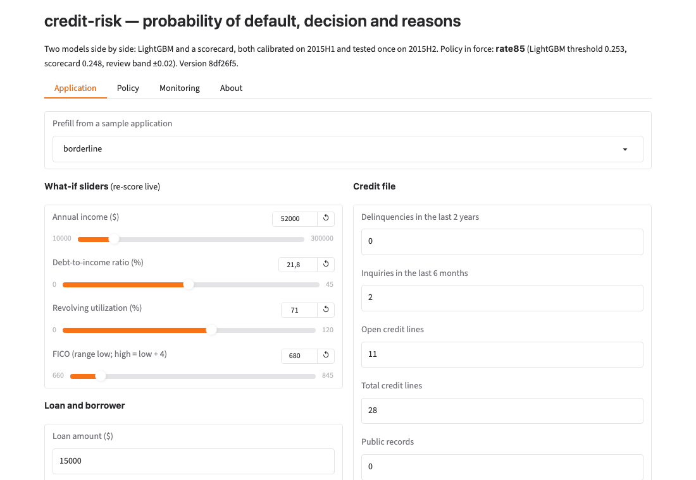
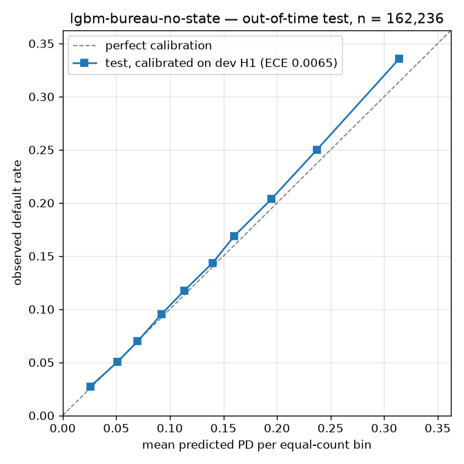

# credit-risk

**Scores a loan application: probability of default, an approve / review / decline decision chosen by expected profit, and the top reasons in the words a declined applicant must be given.**

[](https://huggingface.co/spaces/DavutKursun/credit-risk) · **Live:** [https://davutkursun-credit-risk.hf.space/ui](https://davutkursun-credit-risk.hf.space/ui) · API docs at [`/docs`](https://davutkursun-credit-risk.hf.space/docs)



## The problem
A lender that approves everyone loses money on defaults; one that declines everyone earns nothing. The useful
question is not "how accurate is the model" but "at which threshold does the book make the most money, and can
the model be trusted on next year's applicants". This project answers that with out-of-time validation,
calibrated probabilities and a profit curve.

## What this does
- Takes an application (amount, rate, income, FICO, debt-to-income, credit history, nine bureau attributes) and returns a calibrated PD
- Decides approve / review / decline by expected profit, with a ±2 point review band for borderline cases
- Explains every decision with five reason codes phrased against approved borrowers, never the Lending Club grade itself
- Compares an auditable scorecard (WoE + logistic regression, sign-consistent) with LightGBM under monotone constraints,
  each with and without Lending Club's own grades and with and without the bureau attributes
- Monitors drift (PSI by quarter, values and missingness apart) and audits approval rates across proxy groups

## Results — out-of-time test, 162,236 loans issued 2015H2, run once on 2026-10-27
Trained on 2012–2014, calibrated and thresholds chosen on 2015H1, tested on 2015H2 with everything frozen.

| | LightGBM (`lgbm-bureau-no-state`) | Scorecard (`scorecard-bureau-no-state`) | Grade only |
|---|---|---|---|
| AUC / Gini / KS | 0.705 / 0.409 / 0.298 | 0.697 / 0.394 / 0.287 | 0.681 / 0.363 / 0.268 |
| ECE after calibration (Brier) | 0.0065 (0.1170) | 0.0092 (0.1178) | n/a |
| **At 85% approval: default rate among approved** | **11.8%** | **11.9%** | 12.3% sub-grade cut · 14.7% approve-all |
| **At 85% approval: realized P&L per approved loan / per $ lent** | **$1,022 / 7.9%** | **$1,012 / 7.8%** | $976 / 7.5% sub-grade cut · $929 / 7.2% approve-all |
| At 85% approval: defaults avoided per 1,000 approvals vs sub-grade cut / vs approve-all | 5.0 / 29.0 | 3.7 / 27.7 | — |
| Expected-value threshold (0.41 / 0.40): approval, review, P&L per approved loan | 99.6%, 0.4%, $937 | 99.6%, 0.4%, $933 | approve-all $929 |
| p50 / p95 latency, `/score`, one application | 7 / 8 ms on an M-series laptop; 15 / 18 ms server-side on the Space (cpu-basic) | 10 / 11 ms laptop; 27 / 36 ms Space | |

The expected-value threshold approves 99.6% because, with a loss given default of 0.31 and 36 months of interest, every grade is
profitable on average: the break-even PD runs from 28% (grade A) to 59% (G), above almost every applicant's PD, so the model's
value is in ranking applicants at the approval rate a lender chooses, not in refusing them.



## Scorecard vs LightGBM: when each wins
| | Scorecard | LightGBM |
|---|---|---|
| Ranking on test | AUC 0.697 | AUC 0.705 (+0.008); at 85% approval 1.3 more defaults avoided per 1,000 approvals |
| Auditability | Points per bin for 22 features, every coefficient's sign agrees with its WoE, readable by a validation team or a regulator line by line | 511 trees; exact SHAP contributions per feature, monotone constraints on 20 features give the same directional guarantees |
| Calibration | Isotonic on dev, ECE 0.009 on test | Isotonic on dev, ECE 0.007 on test |
| Explanations | Points per feature; five reasons per decision | SHAP per feature; five reasons per decision; the two models' top-3 reasons overlap for 98% of applications |
| Choose it when | Every line must be defensible to a reviewer and 0.8 AUC points are not worth the opacity | Each tenth of a point of default rate matters at scale and SHAP explanations are accepted |
| Latency, one `/score` call on the Space CPU | p50 27 ms (three WoE transforms per call) | p50 15 ms |

## Honest notes
- **Lending Club's grade carries information the public attributes do not hold.** Without it both models fall below the grade
  alone (AUC 0.676 and 0.655 against 0.681); with it they add 0.023 and 0.015. A lender
  without such a grade should read the "no LC grade" numbers.
- **Features drift, the scores do not.** Interest rate PSI 0.32 and listing status 0.61 by 2015Q4 (repricing and a channel change at
  Lending Club); the deployed scores stay below 0.02. The bureau attributes show PSI 0.49 only from an early-2012 missing block, which the
  report lists apart from value drift.
- **Fairness is audited on proxies, not claimed.** At 85% approval the four-fifths ratio is 0.72 (LightGBM) / 0.63 (scorecard) across
  income quintiles, 0.86 / 0.83 across home ownership, 0.95 / 0.94 across states (`addr_state` is not a feature). The lowest income
  quintile defaults at 19.5% against 10.5% for the highest and is approved 69.5% against 96.3%: the model turns a
  9-point difference in risk into a 27-point difference in approval. The audit shows this; it cannot say whether a lender may act on it.
- **The test split was touched once**, on 2026-10-27, with the dev thresholds unchanged; details in `docs/DESIGN.md` §9.

## Try the API
```bash
curl -s -X POST "https://davutkursun-credit-risk.hf.space/score?model=lgbm" -H "content-type: application/json" -d '{
  "loan_amnt": 15000, "int_rate": 15.6, "installment": 524.3, "annual_inc": 52000, "dti": 21.8,
  "fico_range_low": 680, "fico_range_high": 684, "delinq_2yrs": 0, "inq_last_6mths": 2, "open_acc": 11, "pub_rec": 0,
  "revol_bal": 12800, "revol_util": 71.0, "total_acc": 28, "mort_acc": 0, "pub_rec_bankruptcies": 0,
  "earliest_cr_line": "Mar-2006", "emp_length": "4 years", "grade": "C", "sub_grade": "C5", "home_ownership": "RENT",
  "verification_status": "Verified", "purpose": "debt_consolidation", "addr_state": "FL",
  "acc_open_past_24mths": 5, "bc_open_to_buy": 4300, "total_bc_limit": 15000, "bc_util": 71.3, "tot_cur_bal": 31500,
  "num_tl_op_past_12m": 2, "mo_sin_rcnt_tl": 4, "mths_since_recent_inq": 2, "percent_bc_gt_75": 50.0
}'
```
```json
{"pd": 0.253, "decision": "review",
 "reasons": [{"feature": "installment_to_income", "value": "0.12", "direction": "raises",
              "text": "Installment relative to income 0.12 is higher than 75% of approved borrowers", "contribution": 0.11}, "… four more"],
 "adverse_action": null, "score_points": null,
 "policy": "rate85", "threshold": 0.253, "review_band": 0.02,
 "model": "lgbm-bureau-no-state", "version": "63b12c1", "latency_ms": 15}
```
`model=scorecard` adds `score_points`; a decline fills `adverse_action` with the notice text. `POST /score/batch` takes
`{"applications": [...]}` with at most 1,000 rows (1,309 rows/s locally); `GET /health` says which policy and
thresholds are in force (`POLICY=rate85`, the 85% operating point, or `POLICY=ev`); `GET /monitoring` returns the PSI table.
Unknown fields and out-of-range values are rejected with 422. The Space answers one application in 15 ms server-side
(LightGBM; round trip from Europe about 170 ms) and 27 ms for the scorecard, measured over 30 calls.

## Limits and privacy
Historical public data from one lender (2012–2015 vintages, matured loans only). No bureau pull, no income verification, no
pricing, no regulatory sign-off, no claim about other markets or years. The Lending Club grade and rate enter the models but are
never given as a reason. Nothing you send is stored: the server logs the method, path, status and latency of each call, never a field;
the Space keeps no state. **Not a credit decision system.**

## More
- [docs/DESIGN.md](docs/DESIGN.md): cohort and censoring, leakage audit, economics, models, calibration, decisions, fairness, drift, the single test run
- [docs/model_card.md](docs/model_card.md): intended use, training data, evaluation, limitations, ethical considerations
- `eval/results/`: every table and plot in this README, the dev reports and the test run
- [space/README.md](space/README.md): the Space card; `Dockerfile` and `requirements-space.txt` build the same image locally

## Data
Lending Club 2007–2018Q4 (Kaggle `wordsforthewise/lending-club`, public). 36-month loans issued 2012–2015, fully
matured by the snapshot. Train 2012–2014 · dev 2015H1 · test 2015H2 (out-of-time). Post-origination columns are
never features; see `credit_risk/leakage.py`.

## Run it yourself
```bash
pip install -r requirements-dev.txt && pytest -q        # no data needed
python scripts/download.py                              # tells you where to put the raw file
make cohort audit                                       # cohort, leakage audit, economics on train
python scripts/train.py --model both --bureau --no-state   # the deployed pair (see scripts/train.py --help for the ablations)
python scripts/evaluate.py --split dev && python scripts/policy_eval.py --split dev --variants lgbm-bureau-no-state,scorecard-bureau-no-state
python scripts/reasons_report.py --variants lgbm-bureau-no-state,scorecard-bureau-no-state --policy-rate 0.85
python scripts/fairness_report.py --model lgbm-bureau-no-state --split dev && python scripts/drift_report.py
```
