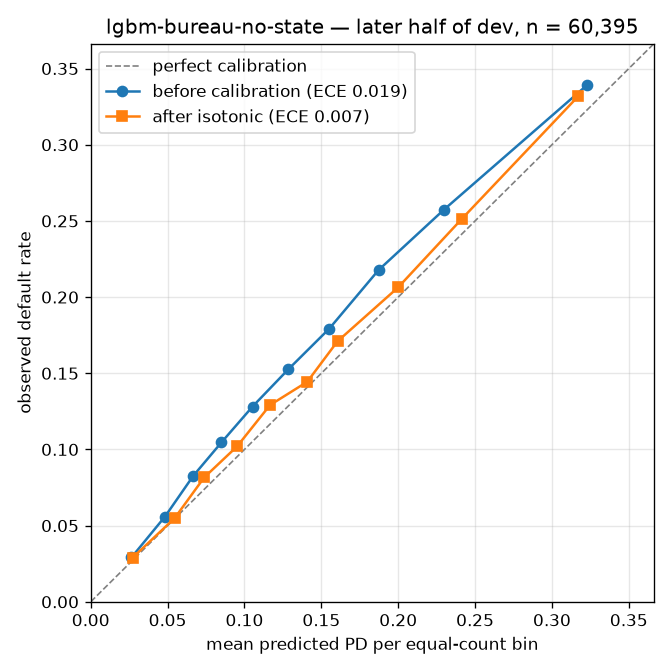
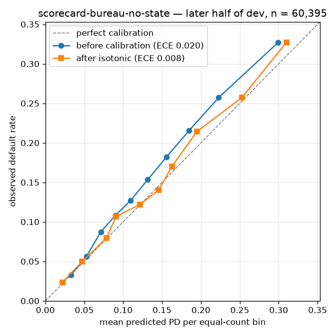
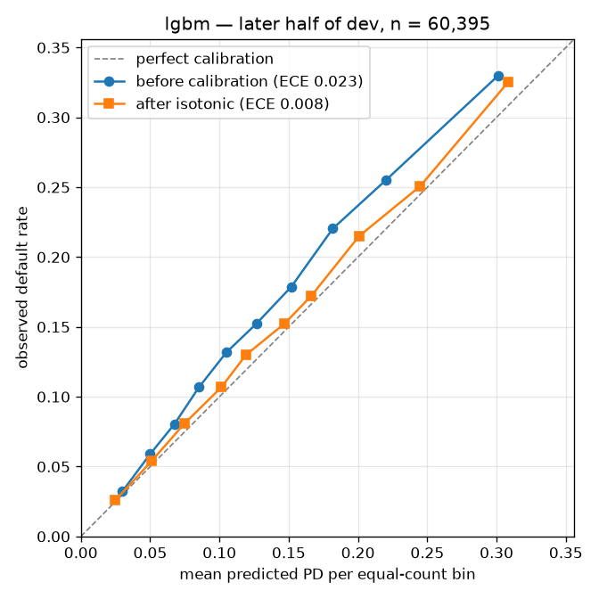
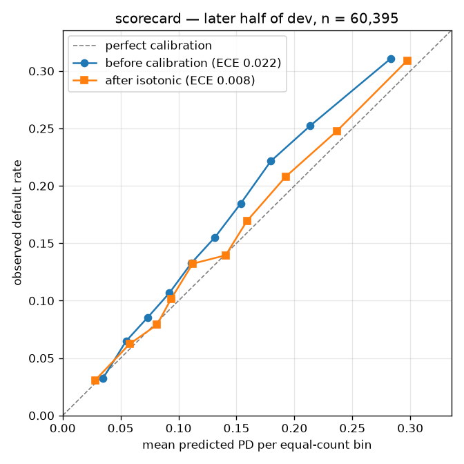
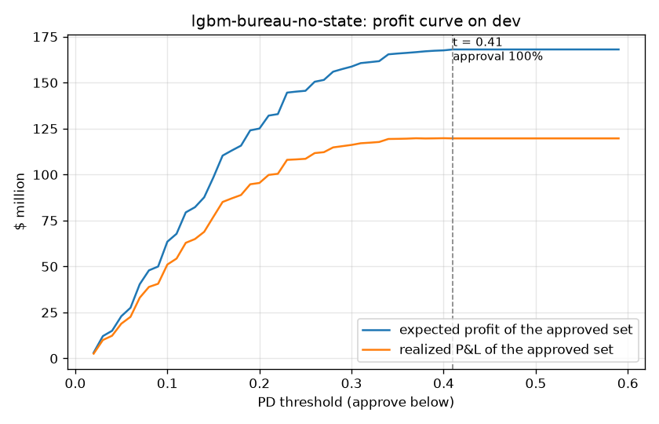
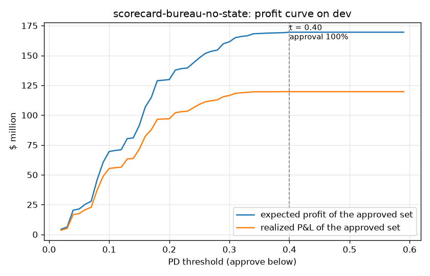
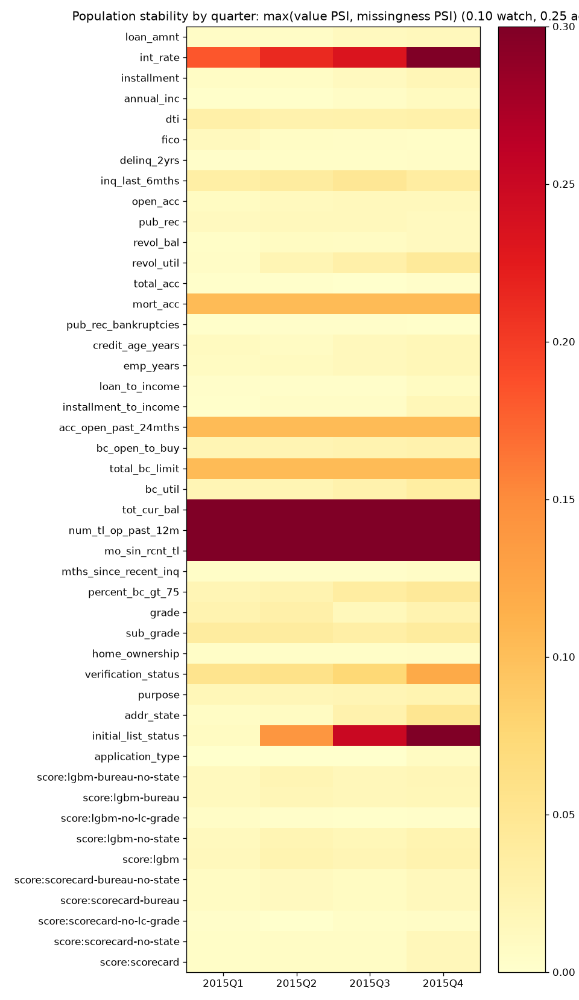

# Design notes

Filled milestone by milestone. Each section states what was measured, on which split, and what it changes.

## 1. Cohort and censoring (M1)

**Why only 36-month loans issued 2012-01 → 2015-12.** The export is a snapshot whose payment history runs to March 2019
(798,471 of the 2016–2018 loans have their last payment in Mar-2019; credit pulls run to Apr-2019); "2018Q4" in the file
name is the issuance coverage. A 36-month loan issued in Dec-2015 has its 36th scheduled payment in Dec-2018, so every loan
in the window has had its full term plus about three months of slack. 60-month loans and 2016+ cohorts are right-censored:
a loan that is "Current" at the snapshot may still default, and keeping only the finished ones would bias the other way,
because prepayments finish early while the loans that will default are still open (2016 36-month loans: 14.2% charged off
among all, 19.8% among the finished ones). Next step for those cohorts: a survival model (time to default) that uses the
censored loans.

| Vintage | 36-month loans | not yet terminal | charged off | 60-month loans | not yet terminal | charged off |
|---|---|---|---|---|---|---|
| 2012 | 43,470 | 0.0% | 13.6% | 9,897 | 0.0% | 27.7% |
| 2013 | 100,422 | 0.0% | 12.3% | 34,392 | 0.0% | 25.1% |
| 2014 | 162,570 | 0.0% | 13.7% | 73,059 | 17.2% | 25.8% |
| 2015 | 283,173 | 0.1% | 14.9% | 137,922 | 32.9% | 24.4% |
| 2016 | 323,495 | 28.2% | 14.2% | 110,912 | 45.2% | 20.0% |
| 2017 | 320,419 | 59.9% | 8.0% | 123,160 | 66.9% | 10.9% |

**Filters** (`data/cohort/build_report.json`; the raw file has 2,260,701 lines):

| Step | Rows dropped | Remaining |
|---|---|---|
| raw lines in the export | | 2,260,701 |
| 33 non-loan lines: 32 "Total amount funded in policy code N" trailers and one "Loans that do not meet the credit policy" separator, all with empty `loan_amnt` | 33 | 2,260,668 |
| term ≠ 36 months (all are 60-month loans) | 650,914 | 1,609,754 |
| issue_d outside 2012-01..2015-12 (31,534 issued 2007–2011; 988,585 issued 2016–2018) | 1,020,119 | 589,635 |
| non-terminal status (Current, Late, In Grace Period) | 147 | 589,488 |

**Loans per issue year × status** (`data/cohort/summary.json`). Only two statuses survive the filters; the 147 loans still
open at the snapshot are listed with the year they were issued in.

| Issue year | Fully Paid | Charged Off | Default | still open (dropped) | Default rate |
|---|---|---|---|---|---|
| 2012 | 37,567 | 5,903 | 0 | 0 (0.00%) | 13.6% |
| 2013 | 88,044 | 12,378 | 0 | 0 (0.00%) | 12.3% |
| 2014 | 140,255 | 22,315 | 0 | 0 (0.00%) | 13.7% |
| 2015 | 240,894 | 42,132 | 0 | 147 (0.05%) | 14.9% |

| Split | Loans | Share | Issue months | Default rate |
|---|---|---|---|---|
| train | 306,462 | 52.0% | 2012-01 → 2014-12 | 13.25% |
| dev | 120,790 | 20.5% | 2015-01 → 2015-06 | 15.12% |
| test | 162,236 | 27.5% | 2015-07 → 2015-12 | 14.71% |

**The 147 maturity-boundary drops.** 147 of the 283,173 36-month loans issued in 2015 (0.052%) had no terminal status at the
snapshot: Current 72, Late 31–120 days 61, In Grace Period 9, Late 16–30 days 5. By issue month: Jan 1, Jul 2, Aug 1, Sep 2,
Oct 16, Nov 27, Dec 98, so 141 of them are 2015Q4 issues (0.32% of the December 2015 loans), 146 fall in the test window and one
in dev. These are loans on extended or delinquent schedules at the very end of their term, not an unmatured cohort. If every one
of them eventually defaulted the 2015 default rate would be 14.93% instead of the reported 14.89%; if every one repaid, 14.88%.
The realistic effect (the 75 late or in-grace loans default, the 72 current ones repay) is about +0.02 points, below the
sampling error of the test rate (0.09 points). Dropping them makes the reported 2015 rate very slightly optimistic.

**No "Default" status.** Lending Club uses "Default" for loans 121+ days past due before charge-off. The export has 40 such
rows, all 60-month loans or 2016+ issues; none among 36-month 2012–2015 loans, so the target is exactly Charged Off versus
Fully Paid. The filter would count "Default" as bad if it occurred.

**2011 is excluded as a different pricing era.** The 2,749 "Does not meet the credit policy" rows (761 charged off, 1,988 fully
paid) are all 2007–2010 issues; `policy_code` is 1.0 for every one of the 2,260,668 loan rows, so policy-exception loans are
marked only by the `loan_status` prefix and a policy-code filter would be a no-op. The 14,101 36-month loans of 2011 (10.6%
charged off) are excluded by the window alone: a different product and pricing era, small volume, and none of the bureau
attributes of section 2 exist before 2012.

**Default rate by grade.** `summary.json` pools all four vintages, which includes the 2015 labels of dev and test; the train-only
row is the one to reason from until the single test run.

| Grade | A | B | C | D | E | F | G |
|---|---|---|---|---|---|---|---|
| all vintages 2012–2015 | 5.5% | 11.2% | 18.0% | 23.6% | 28.9% | 33.1% | 40.2% |
| train only (2012–2014) | 5.5% | 10.7% | 16.6% | 21.4% | 25.6% | 28.5% | 33.5% |

**Vintage effects, and why calibration on dev matters.** The 2013 dip is real and inside every grade: grade-standardised default
rates are 14.3% (2012), 12.2% (2013), 13.6% (2014), the monthly series runs from 15.6% in Jun-2012 down to 11.8% in Dec-2013 and
back to 14.9% in Oct-2014, and 2013 carried the highest mean interest rate (13.37% versus 12.63% and 12.47%). The 2015 vintage
goes the other way: dev defaults at 15.12% and test at 14.71% against 13.25% on train, although their grade mix is safer (grade A
is 25.4% and 24.3% of dev and test versus 20.6% of train). Re-weighting train's sub-grade default rates to the 2015 mix predicts
13.13% for dev and 12.63% for test, so the within-sub-grade residual is +1.99 and +2.08 points: a model trained on 2012–2014 will
under-predict 2015 PD by about two points inside a sub-grade before calibration, and the uncalibrated reliability plots will sit
below the diagonal. That is what the calibrator fitted on the earlier half of dev corrects, and test is where it is judged. The
dev-to-test difference itself (15.12% versus 14.71%) is grade mix, not a change in within-grade risk.

**Data quirks that affect features.**
- `mort_acc` is missing for 13.9% of the 2012 loans and never afterwards (0% in dev and test): it entered the export in March 2012
  together with the first bureau attributes. A "missing" bin for it is learned on 2012 rows only and has no support at scoring time.
- The bureau attribute set (section 2) is missing for the loans listed before Sep-2012: 7.4% of train, 0% of dev and test. This is
  a known effect, not a defect: those rows default at 14.1% against 13.2% for the rest, so the missing bin is a weak early-2012
  vintage proxy that a model never meets after training. The train window stays 2012-01 → 2014-12 for both models, nothing is
  imputed, missing is its own bin (LightGBM's native handling, optbinning's missing bin), and the drift report shows the missing
  share separately so that it cannot masquerade as a value shift.
- `emp_length` missingness rises from 4.0% (2012) to 5.9% (2014), 6.2% (dev) and 7.1% (test); `revol_util` is missing for under
  0.1%; `dti` and `pub_rec_bankruptcies` are complete.
- `application_type` is "Individual" for every train and dev loan; the 239 "Joint App" rows (0.15%) are all in test.
- `int_rate` and `revol_util` are already numeric in this export and `emp_length` blanks are empty cells, not the string "n/a";
  `features.py` handles both forms, so the string quirks of CLAUDE.md section 11 are exercised by the synthetic frame.
- Monthly issuance is lumpy from mid-2014 (2014-09: 7,371 loans, 2014-10: 26,573), a batch-issuance artefact of `issue_d`; quarters
  are the right granularity for drift, and test is 34% larger than dev for this reason.

## 2. Leakage audit (M1)

**Method.** `credit_risk/leakage.py` flags every one of the 151 raw columns: True (known at origination), False (post-origination:
payments, recoveries, hardship, settlement, refreshed bureau pulls) or None (no usable data). `audit()` computes, on train only, the
single-feature AUC of every column's values and of its missingness (categoricals through an in-sample target-rate encoding, an
optimistic screen; percent strings and "Mon-YYYY" months parsed as numbers). Any True- or None-flagged column above 0.80 stops the
pipeline. The flag table is the primary control and the AUC screen a backstop: known post-origination columns such as
`total_pymnt` (0.756), `last_credit_pull_d` (0.684) and `last_pymnt_d` (0.670) score below the line.

**Top 15 single-feature AUCs on train** (`eval/results/leakage_audit_train.csv`; the flags are the final ones, after the decision
below; at audit time the bureau columns were still None):

| # | Column | Flag (final) | AUC (value) | AUC (missingness) | Non-null |
|---|---|---|---|---|---|
| 1 | `loan_status` | False | 1.000 |  | 1.000 |
| 2 | `recoveries` | False | 0.919 |  | 1.000 |
| 3 | `collection_recovery_fee` | False | 0.867 |  | 1.000 |
| 4 | `total_pymnt` | False | 0.756 |  | 1.000 |
| 5 | `sub_grade` | True | 0.650 |  | 1.000 |
| 6 | `int_rate` | True | 0.647 |  | 1.000 |
| 7 | `grade` | True | 0.640 |  | 1.000 |
| 8 | `fico_range_high` | True | 0.597 |  | 1.000 |
| 9 | `fico_range_low` | True | 0.597 |  | 1.000 |
| 10 | `annual_inc` | True | 0.585 |  | 1.000 |
| 11 | `bc_open_to_buy` | True | 0.578 | 0.501 | 0.971 |
| 12 | `tot_hi_cred_lim` | True | 0.577 | 0.503 | 0.926 |
| 13 | `total_bc_limit` | True | 0.574 | 0.500 | 0.980 |
| 14 | `avg_cur_bal` | True | 0.572 | 0.503 | 0.926 |
| 15 | `acc_open_past_24mths` | True | 0.568 | 0.500 | 0.980 |

0 suspicious columns, 0 among feature source columns. The three columns above 0.80 are the economics columns flagged False, which
is the screen working as intended. The best legitimate single feature is `sub_grade` at 0.650; `fico` scores 0.597, `annual_inc`
0.585, `dti` 0.563. Derived model inputs are in the same range (`installment_to_income` 0.572, `loan_to_income` 0.558,
`credit_age_years` 0.540, `emp_years` 0.517). The economics columns live in the cohort parquet for section 3 but cannot reach a
model: `make_features` reads only the raw feature columns, `assert_no_leaks` runs on every training run, and the `Application`
schema rejects them. `id` and `member_id` are flagged True (they are origination data) but sit in `IDENTIFIERS`, which
`usable_columns()` excludes: `id` is assigned sequentially and tracks the issue month (Spearman 0.99), a vintage proxy.
Coverage: 97 of the 151 raw columns were screened on real data (the 33 cohort columns and the 64 bureau columns); the remaining 36
False-flagged and 17 True-flagged columns are never read by the pipeline.

### Bureau attributes: the decision

Lending Club added 64 bureau attributes to its export over 2012–2017. The data dictionary does not say whether they are captured
at listing or refreshed by later credit pulls (`last_credit_pull_d` is on median 52 months after issue on train), so they started
as None. M1 tested them on train and decided:

| Group (first listed) | Columns | Missing on train 2012 / 2013 / 2014 | Flag | Decision and reason |
|---|---|---|---|---|
| Since 2008 | 2: `chargeoff_within_12_mths`, `delinq_amnt` | 0% / 0% / 0% | True | Origination-time (no refresh signature: `chargeoff_within_12_mths` > 0 for 0.71% of fully paid vs 0.70% of charged-off borrowers; `delinq_amnt` > 0 agrees with `acc_now_delinq` > 0 in 99.83%). Near-constant, AUC 0.500: not features. |
| Mar 2012 | 9: `acc_open_past_24mths`, `total_bal_ex_mort`, `total_bc_limit`, `bc_open_to_buy`, `bc_util`, `percent_bc_gt_75`, `mths_since_recent_bc`, `mths_since_recent_inq`, `mths_since_recent_revol_delinq` | 14–74% / 0–70% / 0–64% | True | Origination-time; the Lending Club loan never appears in `acc_open_past_24mths`; `mths_since_recent_inq` ≤ 6 whenever `inq_last_6mths` > 0 (99.99%). Source of 7 of the 9 opt-in features. |
| Jun 2012 | 2: `num_sats`, `num_bc_sats` | 30% / 0% / 0% | True | Origination-time, but `num_sats` equals `open_acc` in 96.7% of rows and `num_bc_sats` has AUC 0.501: not features. |
| Aug/Sep 2012 | 24: `tot_coll_amt`, `tot_cur_bal`, `total_rev_hi_lim`, `avg_cur_bal`, `tot_hi_cred_lim`, `total_il_high_credit_limit`, `mo_sin_old_il_acct`, `mo_sin_old_rev_tl_op`, `mo_sin_rcnt_rev_tl_op`, `mo_sin_rcnt_tl`, `mths_since_recent_bc_dlq`, `num_accts_ever_120_pd`, `num_actv_bc_tl`, `num_actv_rev_tl`, `num_bc_tl`, `num_il_tl`, `num_op_rev_tl`, `num_rev_accts`, `num_rev_tl_bal_gt_0`, `num_tl_120dpd_2m`, `num_tl_30dpd`, `num_tl_90g_dpd_24m`, `num_tl_op_past_12m`, `pct_tl_nvr_dlq` | 52–87% / 0–78% / 0–73% | True | Origination-time by every test (identities, no ageing, never backfilled). Source of `tot_cur_bal`, `num_tl_op_past_12m`, `mo_sin_rcnt_tl`; the rest are redundant (`total_rev_hi_lim` = `revol_bal` / `revol_util`, `mo_sin_old_rev_tl_op` ≈ credit age) or near-constant. |
| Dec 2015 | 14: `open_acc_6m`, `open_act_il`, `open_il_12m`, `open_il_24m`, `mths_since_rcnt_il`, `total_bal_il`, `il_util`, `open_rv_12m`, `open_rv_24m`, `max_bal_bc`, `all_util`, `inq_fi`, `total_cu_tl`, `inq_last_12m` | 100% / 100% / 100% | None | No data in the 2012–2015 cohort: 100% missing in train and dev, present for about half of the December 2015 test loans only. |
| 2017 joint | 13: `revol_bal_joint`, `sec_app_fico_range_low`, `sec_app_fico_range_high`, `sec_app_earliest_cr_line`, `sec_app_inq_last_6mths`, `sec_app_mort_acc`, `sec_app_open_acc`, `sec_app_revol_util`, `sec_app_open_act_il`, `sec_app_num_rev_accts`, `sec_app_chargeoff_within_12_mths`, `sec_app_collections_12_mths_ex_med`, `sec_app_mths_since_last_major_derog` | 100% / 100% / 100% | None | No data: co-borrower fields exist only for joint applications from 2017; every train application is Individual. |

Evidence that the 37 columns with data are captured at listing and never refreshed (all on train; the per-row checks and the
compact frame behind them are under the gitignored `scratchpad/m1/`):
- **Never backfilled.** Loans listed before a field existed stay 100% missing although 99% of them had later credit pulls (median
  last pull in 2017). A refresh or backfill would have populated them.
- **The Lending Club loan itself never appears.** `acc_open_past_24mths` is zero for 4.6% of the loans whose last pull came within
  24 months of issue, the same as the 4.9% base rate; `num_il_tl` is zero for 4.0% of borrowers and `total_il_high_credit_limit` is
  zero for 99.95% of them; `num_tl_op_past_12m` is zero for 18.3% of loans pulled within 12 months of issue (base rate 18.7%).
- **"Months since" fields do not age.** Their slope against the months elapsed to the last credit pull is 0.004 to 0.118 per month
  (within-issue-month slopes 0.015 or less); a refreshed field would grow by about one per month.
- **Same-date identities hold to the row.** `revol_util` equals 100 × `revol_bal` / `total_rev_hi_lim` within two points for 96.4% of
  loans (correlation 0.981); `num_tl_30dpd` equals `acc_now_delinq` in 99.85%; `tot_cur_bal` is never below `revol_bal`;
  `num_rev_accts` + `num_il_tl` never exceeds `total_acc`; borrowers with `mort_acc` = 0 show no mortgage balance in
  `tot_cur_bal` − `total_bal_ex_mort` (99.8% exactly zero).
- **No trace of the borrower's own charge-off.** 98% of charged-off borrowers were pulled again after their last payment, yet
  `chargeoff_within_12_mths` is positive for 0.71% of fully-paid and 0.70% of charged-off borrowers, `num_tl_120dpd_2m` for 0.08%
  and 0.06%, `num_accts_ever_120_pd` for 21.5% and 23.6%; every delinquency counter has AUC 0.500 to 0.510 against 0.76 to 0.92 for
  the truly post-origination columns. The same identities and absence tests hold, label-free, on the 283,173 loans issued in 2015.
- **AUC is in the origination range.** The strongest bureau column, `bc_open_to_buy`, scores 0.578, below `annual_inc`; nothing
  reaches 0.60.

**Date-convention note on `mo_sin_old_rev_tl_op`.** For 18.1% of train rows it exceeds the credit-file age computed from
`earliest_cr_line` at issue, which cannot happen at the same date. The excess is 2 to 7 months in every case (median 3, never
more than 10), confined to loans listed Aug-2012 to Oct-2013 (46–59% of each month, 0% from Dec-2013 on), and unrelated to the
pull date (correlation with elapsed months −0.001) and to the outcome. Under a refresh the excess would equal the elapsed months
(median 52). It is a convention offset in `earliest_cr_line`, which `credit_age_years` inherits for those rows (about 0.25 years
on a 15-year median); the two fields must never be differenced against each other.

**The opt-in feature set.** Flagging a column True makes it eligible; it does not put it in the model. Of the 37, most are
duplicates of existing features or of each other (`num_sats` ≈ `open_acc`, `total_rev_hi_lim` = `revol_bal` / `revol_util`,
`mo_sin_old_rev_tl_op` ≈ credit age, `num_tl_30dpd` ≈ `acc_now_delinq`), near-constant (`num_tl_120dpd_2m` is 99.93% zeros) or
structurally sparse. Nine non-redundant columns form `features.BUREAU_FEATURES`, an opt-in set (`make_features(..., bureau=True)`,
`train.py --bureau`, bundle variants `-bureau`) that M2 evaluates as an ablation against the section 3.3 list, which stays the
default. They are optional fields of the `Application` schema; None means "not on file" and stays NaN, with no imputation.
`mths_since_recent_inq` missing means "no inquiry on file" and is itself informative (default rate 10.3% versus 13.7%), so the
API must distinguish "not supplied" from "no inquiry".

| Feature | Monotone constraint | Missing on train 2012 / 2013 / 2014 | Train AUC |
|---|---|---|---|
| `acc_open_past_24mths` | +1 | 13.9% / 0.0% / 0.0% | 0.568 |
| `bc_open_to_buy` | -1 | 14.8% / 0.8% / 1.1% | 0.578 |
| `total_bc_limit` | -1 | 13.9% / 0.0% / 0.0% | 0.574 |
| `bc_util` | +1 | 14.9% / 0.8% / 1.2% | 0.551 |
| `tot_cur_bal` | +0 | 51.9% / 0.0% / 0.0% | 0.565 |
| `num_tl_op_past_12m` | +1 | 51.9% / 0.0% / 0.0% | 0.562 |
| `mo_sin_rcnt_tl` | -1 | 51.9% / 0.0% / 0.0% | 0.555 |
| `mths_since_recent_inq` | -1 | 25.1% / 11.2% / 9.5% | 0.543 |
| `percent_bc_gt_75` | +1 | 14.8% / 0.8% / 1.1% | 0.554 |

## 3. Economics (M1)

Estimated on train only (`scripts/economics.py` → `eval/results/economics_train.json`, `economics_train.md`). LGD is 1 minus the
recovery rate on the 40,596 charged-off train loans, recovery = (`total_pymnt` + `recoveries` − `collection_recovery_fee`)
/ `funded_amnt`, capped to [0, 1]: mean 0.314, median 0.290, and almost flat across grades (0.31 to 0.33). Gain if
repaid is the scheduled interest, `installment` × 36 − `funded_amnt`, an upper bound because of prepayment; loss if default is
LGD × `funded_amnt`; the break-even PD of a loan is gain / (gain + loss), the PD at which approving it has zero expected profit.

| Grade | Loans | Default rate | LGD mean | LGD median | n defaults | Gain if repaid (median) | Loss if default (median) | Break-even PD (median) | Break-even PD, grade LGD | Interest > LGD × principal | Realized P&L / loan |
|---|---|---|---|---|---|---|---|---|---|---|---|
| A | 63,143 | 5.5% | 0.323 | 0.291 | 3,458 | $1,503 | $3,793 | 28.1% | 27.6% | 0.0% | $1,127 |
| B | 110,578 | 10.7% | 0.310 | 0.283 | 11,790 | $2,042 | $3,314 | 37.7% | 38.0% | 0.0% | $1,361 |
| C | 78,637 | 16.6% | 0.311 | 0.289 | 13,090 | $2,379 | $3,141 | 43.2% | 43.5% | 0.0% | $1,408 |
| D | 40,103 | 21.4% | 0.318 | 0.297 | 8,582 | $2,762 | $3,000 | 48.6% | 48.3% | 25.8% | $1,400 |
| E | 11,092 | 25.6% | 0.319 | 0.301 | 2,837 | $2,954 | $2,638 | 52.9% | 52.5% | 97.2% | $1,377 |
| F | 2,691 | 28.5% | 0.334 | 0.313 | 766 | $2,676 | $2,018 | 56.9% | 55.3% | 100.0% | $1,238 |
| G | 218 | 33.5% | 0.332 | 0.348 | 73 | $5,633 | $3,954 | 58.7% | 57.4% | 99.5% | $2,019 |

| Interest rate band | Loans | Default rate | Gain if repaid (median) | Loss if default (median) | Break-even PD (median) | Interest > LGD × principal | Realized P&L / loan |
|---|---|---|---|---|---|---|---|
| 5–10% | 79,636 | 6.1% | $1,558 | $3,769 | 28.7% | 0.0% | $1,143 |
| 10–15% | 146,165 | 13.0% | $2,149 | $3,141 | 40.1% | 0.0% | $1,364 |
| 15–20% | 69,223 | 20.1% | $2,692 | $3,125 | 47.4% | 18.2% | $1,453 |
| 20–25% | 11,084 | 25.0% | $2,833 | $2,419 | 53.8% | 100.0% | $1,447 |
| 25–30% | 354 | 36.7% | $4,314 | $3,019 | 58.7% | 100.0% | $1,350 |

What the table says for the decision policy:
- **Every grade clears its break-even on average.** Observed default rates run from 5.5% (A) to 33.5% (G) against median break-even
  PDs from 28% to 59%, and realized P&L on train is positive in every grade ($1,127 to $2,019 per loan; 10.7% per dollar
  lent overall). The portfolio makes money by approving almost everyone, which is why "approve all" is a baseline the policy must
  beat on realized P&L, not a straw man.
- **For most loans a default costs more than a repayment earns.** Scheduled interest exceeds LGD × principal for only
  7.8% of train loans (grades E–G and rates above 20%). A 7.9% loan earns about $1,500 if repaid and loses about
  $3,800 if it defaults, so its break-even PD is 28%; a 24% loan tolerates a PD near 55%. The threshold therefore has to be a
  per-loan expected-value rule, not a single PD cut, and the value of the model lies in ranking inside a grade.
- **The numbers are upper bounds on the gain side.** Prepayment lowers the realized interest (realized P&L per loan is below the
  scheduled gain in every grade), so the profit curves of M3 are judged on realized P&L, with expected profit only choosing the
  threshold on dev.

## 4. Models (M2)

**Setup.** Train = 306,462 loans issued 2012-01..2014-12 (13.25% default); dev = 120,790 loans issued 2015-01..2015-06, sorted by issue
month; the earlier 60,395 dev rows fit the calibrator, the later 60,395 (observed default rate 15.47%) measure it, so every calibration
number below is out-of-sample. Three feature sets: the §3.3 list with Lending Club's grade features (27 features), without them
(22; `grade`, `sub_grade`, `int_rate`, `installment`, `installment_to_income` removed) and with the nine opt-in bureau attributes of
§2 (36). LightGBM: binary objective, learning rate 0.03, 31 leaves, at least 200 loans per leaf, feature and bagging fractions 0.8,
L2 5, early stopping after 100 rounds without dev-AUC improvement (at most 3,000), native categoricals, monotone constraints on
12 / 10 / 20 features. No class weighting: the calibrator sets the level on dev, and re-weighting would distort the probabilities
the policies consume while AUC, which is invariant to monotone transforms, gains nothing from it. Scorecard: optbinning
`BinningProcess` (WoE, monotonic trend where the data allows, features kept at IV ≥ 0.02) + logistic regression (C = 1), scaled to
600 points at odds 1:19 with 20 points to double the odds. Both took seconds on the laptop (peak memory under 1 GB); no scorecard
needed the `max_n_prebins` fallback.

**Dev ranking** (`eval/results/dev-summary.json`, calibrated PD on all 120,790 dev rows; ranking on the raw output is within 0.0005). The six M2 variants, the four M3 `-no-state` ablations and the grade-only reference:

**The `addr_state` ablation (M3) and the deployed pair.** Rule fixed before the run: if training without `addr_state` costs less than
0.003 dev AUC, the deployed model excludes it, because a 50-level geographic proxy that adds almost nothing is a fairness and a drift
liability; otherwise it stays and the loss is stated. Outcome on dev: LightGBM 0.6918 → 0.6908 (−0.0010),
bureau LightGBM 0.6978 → 0.6966 (−0.0012); the scorecards never selected the state
(IV below 0.02), so their numbers are identical. All four pairs fall under the floor: **every deployed model excludes `addr_state`**.
Together with the M2 bureau rule (the nine bureau columns stay if they add at least 0.005 dev AUC: +0.0060 and
+0.0069, they do) the deployed pair is **`lgbm-bureau-no-state`** (dev AUC 0.6966) and **`scorecard-bureau-no-state`**
(0.6890). Ten bundles are kept in `models/` so every ablation can be re-scored on test in M4. Gain shares of the deployed
LightGBM: sub_grade 34.4%, grade 6.8%, int_rate 6.3%, acc_open_past_24mths 5.4%, annual_inc 4.8%, installment_to_income 4.0%, tot_cur_bal 3.6%, dti 3.0%, revol_bal 2.6%, emp_years 2.6%; the geographic share moved mostly into `sub_grade` and `acc_open_past_24mths`.

| Variant | AUC | Gini | KS | PR-AUC | Fit s | Best iteration / selected features |
|---|---|---|---|---|---|---|
| lgbm | 0.6918 | 0.3836 | 0.2808 | 0.2669 | 6.0 | 324 |
| lgbm-no-state | 0.6908 | 0.3815 | 0.2788 | 0.2662 | 8.4 | 430 |
| lgbm-bureau | 0.6978 | 0.3955 | 0.2876 | 0.2748 | 10.2 | 504 |
| lgbm-bureau-no-state **(deployed)** | 0.6966 | 0.3933 | 0.2857 | 0.2734 | 9.2 | 511 |
| scorecard | 0.6821 | 0.3642 | 0.2674 | 0.2531 | 8.4 | 12 |
| scorecard-no-state | 0.6821 | 0.3642 | 0.2674 | 0.2531 | 7.7 | 12 |
| scorecard-bureau | 0.6890 | 0.3780 | 0.2754 | 0.2640 | 10.9 | 22 |
| scorecard-bureau-no-state **(deployed)** | 0.6890 | 0.3780 | 0.2754 | 0.2640 | 11.8 | 22 |
| lgbm-no-lc-grade | 0.6712 | 0.3423 | 0.2492 | 0.2498 | 10.5 | 704 |
| scorecard-no-lc-grade | 0.6497 | 0.2995 | 0.2177 | 0.2286 | 3.8 | 10 |
| grade_only | 0.6750 | 0.3501 | 0.2568 | 0.2499 |  |  |

- **LightGBM beats the scorecard in every pair**: by 0.010 AUC with the LC grade, 0.021 without it, 0.009 with the bureau set. The gap
  is the interactions and the non-monotone shapes a logistic model on WoE bins cannot express.
- **Both models beat the "grade only" reference when they see the grade** (0.692 and 0.683 against 0.675). **Without it they fall below
  it** (0.672 and 0.650): Lending Club's sub-grade carries information the public attributes do not hold, so the "from scratch" models
  are the honest number for a lender that has no such grade, and the LC-grade models are the number for one that does.
- **The bureau set adds +0.0059 AUC and +0.0083 KS to LightGBM, +0.0068 and +0.0079 to the scorecard** on dev,
  above the 0.005 floor set for the ablation; `acc_open_past_24mths` is the fifth feature by gain in the bureau LightGBM. Test decides
  whether it survives out of time.
- **The models still rank inside a grade.** AUC within each grade on dev:

| Variant | A | B | C | D | E | F | G |
|---|---|---|---|---|---|---|---|
| dev loans / default rate | 30,625 / 5.8% | 35,746 / 12.1% | 33,681 / 19.0% | 15,389 / 26.0% | 4,626 / 32.1% | 628 / 41.6% | 95 / 34.7% |
| lgbm | 0.646 | 0.601 | 0.589 | 0.585 | 0.571 | 0.591 | 0.676 |
| scorecard | 0.633 | 0.581 | 0.572 | 0.559 | 0.545 | 0.563 | 0.588 |
| lgbm-no-lc-grade | 0.641 | 0.596 | 0.588 | 0.580 | 0.561 | 0.555 | 0.639 |
| scorecard-no-lc-grade | 0.622 | 0.572 | 0.568 | 0.553 | 0.541 | 0.543 | 0.616 |
| lgbm-bureau | 0.659 | 0.614 | 0.603 | 0.595 | 0.587 | 0.593 | 0.673 |
| scorecard-bureau | 0.647 | 0.597 | 0.587 | 0.573 | 0.567 | 0.583 | 0.594 |

  Inside grade A LightGBM reaches 0.646, inside E 0.571; the scorecard 0.633 and 0.545. A lender using the grade alone has no
  ranking within it, so this is where the models earn their keep (the policy section of M3 measures how much in dollars).

**What drives LightGBM** (`eval/results/lgbm_importance.csv`, share of total gain):
- **lgbm:** sub_grade 36.1%, addr_state 12.2%, grade 9.1%, int_rate 7.1%, annual_inc 5.6%, dti 3.7%, installment_to_income 3.5%, fico 2.5%, revol_bal 2.3%, emp_years 2.2%
- **lgbm-no-lc-grade:** fico 17.6%, addr_state 15.9%, annual_inc 8.9%, loan_to_income 6.4%, revol_bal 6.2%, dti 6.0%, purpose 5.9%, loan_amnt 5.2%, inq_last_6mths 5.0%, mort_acc 3.8%
- **lgbm-bureau:** sub_grade 26.7%, addr_state 11.7%, grade 10.2%, int_rate 6.6%, acc_open_past_24mths 4.8%, annual_inc 4.5%, installment_to_income 3.7%, tot_cur_bal 2.9%, dti 2.8%, emp_years 2.1%

`addr_state` takes 12 to 16% of the gain in every variant with 2,800 splits in the bureau model: a 50-level categorical that native
LightGBM handling can over-fit, and the very proxy the fairness audit of M3 uses. Keep this in view in M3; coarsening or dropping it
is a decision for the fairness report, not for dev AUC.

**The scorecard, line by line** (`eval/results/scorecard_table.md`). Twelve of 27 features survive the IV ≥ 0.02 filter in the
LC-grade card (loan_amnt, installment, annual_inc, dti, fico, delinq_2yrs, inq_last_6mths, open_acc, pub_rec, revol_bal, total_acc, mort_acc, pub_rec_bankruptcies, credit_age_years, emp_years, loan_to_income, installment_to_income, grade, sub_grade, home_ownership, verification_status, purpose, addr_state, initial_list_status, application_type were offered; selected:
annual_inc, dti, fico, inq_last_6mths, mort_acc, credit_age_years, loan_to_income, installment_to_income, grade, sub_grade, home_ownership, purpose), 10 in the no-grade card and 22 of 36 in the bureau card. A scorecard must read
the same way in every row, so training enforces sign consistency: a feature whose logistic coefficient on WoE comes out positive,
which makes its points fall as the bin gets safer, is dropped and the card refitted. That removed `int_rate` and `revol_util` from
the LC-grade card (collinear with `sub_grade` and `grade`, and with `dti` and `loan_to_income`) and `bc_util` from the bureau card
(collinear with `revol_util` and `percent_bc_gt_75`), at no cost: dev AUC 0.6822 → 0.6821 and 0.6888 → 0.6888 on the raw score.
Example rows from the LC-grade card:

| Variable | Bin | Count (%) | Event rate | WoE | Points |
|---|---|---|---|---|---|
| fico | (-inf, 664.50) | 8.8% | 18.5% | -0.40 | 43.89 |
| fico | [664.50, 669.50) | 8.9% | 17.5% | -0.33 | 44.53 |
| fico | [669.50, 674.50) | 9.0% | 17.0% | -0.30 | 44.80 |
| fico | [674.50, 679.50) | 8.1% | 15.7% | -0.20 | 45.67 |
| fico | [679.50, 684.50) | 8.0% | 15.5% | -0.18 | 45.84 |
| fico | [684.50, 689.50) | 7.2% | 14.5% | -0.11 | 46.51 |
| fico | [689.50, 694.50) | 6.9% | 13.2% | 0.00 | 47.47 |
| fico | [694.50, 699.50) | 6.2% | 12.8% | 0.04 | 47.76 |
| fico | [699.50, 704.50) | 5.6% | 11.7% | 0.14 | 48.68 |
| fico | [704.50, 714.50) | 9.2% | 10.7% | 0.24 | 49.61 |
| fico | [714.50, 729.50) | 9.2% | 9.0% | 0.43 | 51.27 |
| fico | [729.50, 754.50) | 7.3% | 7.1% | 0.70 | 53.64 |
| fico | [754.50, inf) | 5.6% | 4.9% | 1.08 | 57.07 |
| fico | Special | 0.0% | 0.0% | 0.00 | 47.45 |
| fico | Missing | 0.0% | 0.0% | 0.00 | 47.45 |
| sub_grade | <ArrowStringArray>
| sub_grade | <ArrowStringArray>
| sub_grade | … | | | | |
| sub_grade | <ArrowStringArray>
| sub_grade | Special | 0.0% | 0.0% | 0.00 | 47.45 |

**Sanity checks** (`scripts/sanity_checks.py`, `eval/results/sanity_dev.json`). The three sample applications of the API schema
score in the right order for all six bundles; every monotonicity probe on the constrained LightGBM features passes (12, 10 and 20
features, swept over the 2nd to 98th dev percentile on a fixed row).

| Variant | clear_approve | borderline | clear_decline |
|---|---|---|---|
| lgbm | 0.041 | 0.301 | 0.999 |
| scorecard | 0.001 (625 pts) | 0.277 (545 pts) | 0.450 (520 pts) |
| lgbm-no-lc-grade | 0.018 | 0.275 | 0.999 |
| scorecard-no-lc-grade | 0.001 (624 pts) | 0.277 (545 pts) | 0.352 (516 pts) |
| lgbm-bureau | 0.024 | 0.281 | 0.999 |
| scorecard-bureau | 0.005 (627 pts) | 0.285 (546 pts) | 0.999 (513 pts) |

The clear-decline sample now scores 0.39–0.42 on every bundle (see the calibration tail in §5).

## 5. Calibration (M2, revised in M3)

Every model under-predicts 2015 before calibration: mean raw PD 0.132–0.137 on the later half of dev against an observed 0.1547, the
vintage shift described in §1 (about two points inside a sub-grade). The calibrator is isotonic regression fitted on the earlier half
of dev and measured on the later half (60,395 rows each). **Since M3 it is fitted on equal-count bins of the calibration rows** (at
least 500 rows per bin, each bin entering with its mean raw PD, its observed default rate and its row count as weight) instead of on
the raw points: with raw points the two or three top-scored calibration rows, which all defaulted, put the last step of the function at
1.0, and an extreme application displayed a PD of 0.999 although the top 1% of raw scores defaults at 34–40%. With bins no step can
exceed the observed rate of a bin, the clear-decline sample now reads 0.39–0.42, and the calibration metrics are unchanged to the
third decimal: ECE falls from 0.018–0.023 to 0.007–0.009 for all ten bundles. Platt scaling fitted on the same rows lands within
0.001 ECE and stays the fallback. One property to know: isotonic pooling makes the calibrated PD flat over stretches of the raw score
(the scorecard maps a range of its highest raw scores to 0.283), so declined applications share PD values while their points still
rank them; policies and reason codes are unaffected.

| Variant | mean PD before → after | ECE before → after | largest bin gap after | clear_decline sample PD |
|---|---|---|---|---|
| lgbm | 0.1320 → 0.1468 | 0.0227 → 0.0079 | 0.0169 | 0.392 |
| lgbm-no-state | 0.1325 → 0.1468 | 0.0222 → 0.0085 | 0.0211 | 0.398 |
| lgbm-bureau | 0.1347 → 0.1471 | 0.0199 → 0.0080 | 0.0194 | 0.415 |
| lgbm-bureau-no-state | 0.1355 → 0.1473 | 0.0191 → 0.0074 | 0.0147 | 0.402 |
| scorecard | 0.1328 → 0.1467 | 0.0224 → 0.0082 | 0.0185 | 0.348 (520 pts) |
| scorecard-no-state | 0.1328 → 0.1467 | 0.0224 → 0.0082 | 0.0185 | 0.348 (520 pts) |
| scorecard-bureau | 0.1351 → 0.1472 | 0.0196 → 0.0082 | 0.0194 | 0.392 (513 pts) |
| scorecard-bureau-no-state | 0.1351 → 0.1472 | 0.0196 → 0.0082 | 0.0194 | 0.392 (513 pts) |
| lgbm-no-lc-grade | 0.1369 → 0.1467 | 0.0178 → 0.0081 | 0.0204 | 0.362 |
| scorecard-no-lc-grade | 0.1333 → 0.1457 | 0.0214 → 0.0090 | 0.0206 | 0.290 (516 pts) |

Reliability plots on the later half of dev, 10 equal-count bins by predicted PD, before (circles) and after (squares) calibration,
45° line = perfect calibration (`scripts/plot_reliability.py`; the deployed pair first):

## 6. Decisions (M3)

**Economics and the expected-value threshold.** With the train economics of §3 (LGD 0.314, scheduled interest as the gain), the
expected profit of approving a loan is positive until its PD reaches 28–59% depending on the rate, so the threshold that maximises
expected profit on the dev profit curve (search floor: 50% approval; review band ±2 points) is high: **0.41 for
`lgbm-bureau-no-state` and 0.40 for `scorecard-bureau-no-state`**, which approves 99.5% of dev applications, sends 0.5% to review and declines
nobody. That is the honest answer of the economics: on this book almost every loan is worth making, and the model's value is not in
refusing applicants but in ranking them. The profit curves (`eval/results/profit_curve_dev_<variant>.png`) are flat near the top
because the marginal loans at PD 0.3–0.4 still earn a little in expectation.

**Fixed approval rates are the operating comparison.** A lender who approves a fixed share asks what the model buys at that share.
At 80, 85 and 90% approval the deployed LightGBM approves 11.6, 12.3 and 13.1% defaulters against 12.1, 12.8 and 13.4% for the Lending
Club sub-grade cut at the same share, i.e. 5.2, 4.0 and 3.0 fewer defaults per 1,000 approvals, and 35, 28 and 20 fewer than approving
everyone; realized P&L per approved loan rises from $991 (approve all) and $1,015 (sub-grade cut at 85%) to $1,063, 8.3 cents per dollar
lent against 7.9. The scorecard captures about two thirds of that gap. **Thresholds carried into M4 unchanged:** expected-value
0.41 / 0.40, and the 85% operating point 0.253 / 0.248 (both stored in `eval/results/policy_dev.json`).

| Policy | PD threshold | Approve | Review | Decline | Default rate among approved | Realized P&L per approved loan | per $ lent | Defaults avoided per 1,000 approvals vs sub-grade cut | vs approve-all |
|---|---|---|---|---|---|---|---|---|---|
| approve_all |  | 100.0% | 0.0% | 0.0% | 15.1% | $991 | 7.8% |  |  |
| approve_grades_A-C |  | 82.8% | 0.0% | 17.2% | 12.5% | $1,018 | 7.9% |  |  |
| sub_grade_cut@80% |  | 80.0% | 0.0% | 20.0% | 12.1% | $1,020 | 7.9% |  |  |
| sub_grade_cut@85% |  | 85.0% | 0.0% | 15.0% | 12.8% | $1,015 | 7.9% |  |  |
| sub_grade_cut@90% |  | 90.0% | 0.0% | 10.0% | 13.4% | $1,010 | 7.9% |  |  |
| lgbm-bureau-no-state@ev | 0.410 | 99.5% | 0.5% | 0.0% | 15.0% | $996 | 7.8% | 0.2 | 1.5 |
| lgbm-bureau-no-state@80% | 0.228 | 80.0% | 0.0% | 20.0% | 11.6% | $1,074 | 8.3% | 5.2 | 35.0 |
| lgbm-bureau-no-state@85% | 0.253 | 85.0% | 0.0% | 15.0% | 12.3% | $1,063 | 8.3% | 4.0 | 27.7 |
| lgbm-bureau-no-state@90% | 0.278 | 90.0% | 0.0% | 10.0% | 13.1% | $1,045 | 8.2% | 3.0 | 19.8 |
| scorecard-bureau-no-state@ev | 0.400 | 99.5% | 0.5% | 0.0% | 15.0% | $995 | 7.8% | -0.0 | 1.2 |
| scorecard-bureau-no-state@80% | 0.229 | 80.0% | 0.0% | 20.0% | 11.8% | $1,068 | 8.2% | 3.9 | 33.7 |
| scorecard-bureau-no-state@85% | 0.248 | 85.0% | 0.0% | 15.0% | 12.5% | $1,057 | 8.2% | 2.7 | 26.4 |
| scorecard-bureau-no-state@90% | 0.281 | 90.0% | 0.0% | 10.0% | 13.3% | $1,039 | 8.1% | 1.7 | 18.5 |

**Reason codes** (`scripts/reasons_report.py`, `eval/results/reasons_dev@85.md`, decisions at the 85% operating point with the ±2
point review band). The Lending Club grade, sub-grade, interest rate and installment never appear as a displayed reason: they are a
score, not a cause an applicant can act on, so `explain.reason_codes` keeps them in the contributions but shows the next underlying
attributes (M4 rule). Over 2,000 random dev rows the two models' top-3 reasons overlap in at least one feature for 98.7% of rows
and name the same #1 reason for 61.8%. The feature that leads the declines:

- lgbm-bureau-no-state: acc_open_past_24mths 42.0%, annual_inc 13.6%, dti 13.4%, emp_years 11.0%, purpose 4.1%, revol_bal 3.0% (over 13,981 declined rows)
- scorecard-bureau-no-state: acc_open_past_24mths 52.6%, annual_inc 26.1%, dti 14.0%, loan_to_income 3.6%, purpose 2.4%, fico 0.7% (over 13,351 declined rows)

Every reason text uses the plain-language label and the approved-population percentile; the check for raw column names or NaN in
any text passes. Five declined and two approved dev loans (ids only), with the adverse-action notice the API returns for a decline:

**Dev loan 50526960, sub-grade D4, rate 17.57%, outcome: charged off.** lgbm-bureau-no-state: PD 0.278, decline. scorecard-bureau-no-state: PD 0.283, decline.

- *lgbm-bureau-no-state*: Accounts opened in the last 24 months 12 is higher than 95% of approved borrowers (+0.42); Debt-to-income ratio 30.6% is higher than 95% of approved borrowers (+0.17); Accounts opened in the last 12 months 8 is higher than 95% of approved borrowers (+0.16); Total bankcard credit limit $3,000 is lower than 95% of approved borrowers (+0.10); Share of bankcards above 75% of their limit 0.0% supports approval (better than 90% of approved borrowers) (−0.09)
  - Notice: Principal reasons for this decision: Accounts opened in the last 24 months 12 is higher than 95% of approved borrowers; Debt-to-income ratio 30.6% is higher than 95% of approved borrowers; Accounts opened in the last 12 months 8 is higher than 95% of approved borrowers; Total bankcard credit limit $3,000 is lower than 95% of approved borrowers.
- *scorecard-bureau-no-state*: Accounts opened in the last 24 months 12 is higher than 95% of approved borrowers (+0.29); Debt-to-income ratio 30.6% is higher than 95% of approved borrowers (+0.14); Accounts opened in the last 12 months 8 is higher than 95% of approved borrowers (+0.06); Share of bankcards above 75% of their limit 0.0% supports approval (better than 90% of approved borrowers) (−0.06); Total bankcard credit limit $3,000 is lower than 95% of approved borrowers (+0.04)
  - Notice: Principal reasons for this decision: Accounts opened in the last 24 months 12 is higher than 95% of approved borrowers; Debt-to-income ratio 30.6% is higher than 95% of approved borrowers; Accounts opened in the last 12 months 8 is higher than 95% of approved borrowers; Total bankcard credit limit $3,000 is lower than 95% of approved borrowers.

**Dev loan 48604527, sub-grade D3, rate 16.99%, outcome: fully paid.** lgbm-bureau-no-state: PD 0.287, decline. scorecard-bureau-no-state: PD 0.283, decline.

- *lgbm-bureau-no-state*: Annual income $24,669 is lower than 95% of approved borrowers (+0.16); Home ownership: RENT (associated with more defaults) (+0.11); Accounts opened in the last 24 months 5 is higher than 75% of approved borrowers (+0.08); FICO score 672 is lower than 90% of approved borrowers (+0.07); Accounts opened in the last 12 months 4 is higher than 95% of approved borrowers (+0.07)
  - Notice: Principal reasons for this decision: Annual income $24,669 is lower than 95% of approved borrowers; Home ownership: RENT (associated with more defaults); Accounts opened in the last 24 months 5 is higher than 75% of approved borrowers; FICO score 672 is lower than 90% of approved borrowers.
- *scorecard-bureau-no-state*: Annual income $24,669 is lower than 95% of approved borrowers (+0.18); Home ownership: RENT (associated with more defaults) (+0.06); Accounts opened in the last 24 months 5 is higher than 75% of approved borrowers (+0.06); FICO score 672 is lower than 90% of approved borrowers (+0.06); Loan amount relative to income 0.32 is higher than 90% of approved borrowers (+0.06)
  - Notice: Principal reasons for this decision: Annual income $24,669 is lower than 95% of approved borrowers; Home ownership: RENT (associated with more defaults); Accounts opened in the last 24 months 5 is higher than 75% of approved borrowers; FICO score 672 is lower than 90% of approved borrowers.

**Dev loan 41348903, sub-grade C5, rate 14.65%, outcome: charged off.** lgbm-bureau-no-state: PD 0.309, decline. scorecard-bureau-no-state: PD 0.279, decline.

- *lgbm-bureau-no-state*: Accounts opened in the last 24 months 12 is higher than 95% of approved borrowers (+0.47); Debt-to-income ratio 34.5% is higher than 95% of approved borrowers (+0.22); Annual income $30,000 is lower than 95% of approved borrowers (+0.17); Accounts opened in the last 12 months 7 is higher than 95% of approved borrowers (+0.13); Months since the most recent credit inquiry 1.0 months is lower than 90% of approved borrowers (+0.11)
  - Notice: Principal reasons for this decision: Accounts opened in the last 24 months 12 is higher than 95% of approved borrowers; Debt-to-income ratio 34.5% is higher than 95% of approved borrowers; Annual income $30,000 is lower than 95% of approved borrowers; Accounts opened in the last 12 months 7 is higher than 95% of approved borrowers.
- *scorecard-bureau-no-state*: Accounts opened in the last 24 months 12 is higher than 95% of approved borrowers (+0.29); Debt-to-income ratio 34.5% is higher than 95% of approved borrowers (+0.14); Annual income $30,000 is lower than 95% of approved borrowers (+0.13); Credit inquiries in the last 6 months 3 is higher than 95% of approved borrowers (+0.08); Loan purpose: credit_card (associated with fewer defaults) (−0.08)
  - Notice: Principal reasons for this decision: Accounts opened in the last 24 months 12 is higher than 95% of approved borrowers; Debt-to-income ratio 34.5% is higher than 95% of approved borrowers; Annual income $30,000 is lower than 95% of approved borrowers; Credit inquiries in the last 6 months 3 is higher than 95% of approved borrowers.

**Dev loan 48676667, sub-grade E1, rate 18.25%, outcome: fully paid.** lgbm-bureau-no-state: PD 0.335, decline. scorecard-bureau-no-state: PD 0.306, decline.

- *lgbm-bureau-no-state*: Employment length: missing (associated with more defaults) (+0.21); Annual income $24,000 is lower than 95% of approved borrowers (+0.15); Total credit lines 5 is lower than 95% of approved borrowers (+0.14); Months since the most recent credit inquiry 1.0 months is lower than 90% of approved borrowers (+0.11); Home ownership: RENT (associated with more defaults) (+0.10)
  - Notice: Principal reasons for this decision: Employment length: missing (associated with more defaults); Annual income $24,000 is lower than 95% of approved borrowers; Total credit lines 5 is lower than 95% of approved borrowers; Months since the most recent credit inquiry 1.0 months is lower than 90% of approved borrowers.
- *scorecard-bureau-no-state*: Annual income $24,000 is lower than 95% of approved borrowers (+0.18); Loan purpose: other (associated with more defaults) (+0.12); Accounts opened in the last 24 months 3 supports approval (better than 50% of approved borrowers) (−0.07); Home ownership: RENT (associated with more defaults) (+0.06); FICO score 672 is lower than 90% of approved borrowers (+0.06)
  - Notice: Principal reasons for this decision: Annual income $24,000 is lower than 95% of approved borrowers; Loan purpose: other (associated with more defaults); Home ownership: RENT (associated with more defaults); FICO score 672 is lower than 90% of approved borrowers.

**Dev loan 46426382, sub-grade D2, rate 16.55%, outcome: fully paid.** lgbm-bureau-no-state: PD 0.387, decline. scorecard-bureau-no-state: PD 0.283, decline.

- *lgbm-bureau-no-state*: Accounts opened in the last 24 months 12 is higher than 95% of approved borrowers (+0.51); Delinquencies in the last 2 years 4 is higher than 95% of approved borrowers (+0.18); FICO score 662 is lower than 95% of approved borrowers (+0.16); Accounts opened in the last 12 months 8 is higher than 95% of approved borrowers (+0.15); Annual income $89,000 supports approval (better than 50% of approved borrowers) (−0.11)
  - Notice: Principal reasons for this decision: Accounts opened in the last 24 months 12 is higher than 95% of approved borrowers; Delinquencies in the last 2 years 4 is higher than 95% of approved borrowers; FICO score 662 is lower than 95% of approved borrowers; Accounts opened in the last 12 months 8 is higher than 95% of approved borrowers.
- *scorecard-bureau-no-state*: Accounts opened in the last 24 months 12 is higher than 95% of approved borrowers (+0.29); Annual income $89,000 supports approval (better than 50% of approved borrowers) (−0.12); FICO score 662 is lower than 95% of approved borrowers (+0.08); Home ownership: RENT (associated with more defaults) (+0.06); Accounts opened in the last 12 months 8 is higher than 95% of approved borrowers (+0.06)
  - Notice: Principal reasons for this decision: Accounts opened in the last 24 months 12 is higher than 95% of approved borrowers; FICO score 662 is lower than 95% of approved borrowers; Home ownership: RENT (associated with more defaults); Accounts opened in the last 12 months 8 is higher than 95% of approved borrowers.

## 7. Fairness audit (M3)

The data carries no protected attribute. The audit runs on proxies: state (top 10 by volume, the rest pooled), income quintile,
employment-length band and home ownership, on dev, for both deployed models, at the expected-value threshold and at the 85% operating
point, with the ±2 point review band (`scripts/fairness_report.py`, `eval/results/fairness_dev_<variant>[@85]_<group>.csv`). The
four-fifths ratio is the smallest group approval rate over the largest.

| Model, threshold | State (top 10) | Income quintile | Employment band | Home ownership |
|---|---|---|---|---|
| lgbm-bureau-no-state, expected value (t = 0.410) | 0.998 | 0.988 | 0.991 | 0.994 |
| lgbm-bureau-no-state, 85% operating point (t = 0.253) | 0.956 | 0.688 | 0.723 | 0.846 |
| scorecard-bureau-no-state, expected value (t = 0.400) | 0.997 | 0.981 | 0.990 | 0.992 |
| scorecard-bureau-no-state, 85% operating point (t = 0.248) | 0.938 | 0.586 | 0.813 | 0.810 |

At the expected-value threshold nearly everyone is approved and every ratio is above 0.98, which says nothing. At the 85% operating
point the picture is the one a lender has to defend. For `lgbm-bureau-no-state` the gaps (max − min across groups):

| Group | Approval-rate gap | Default-rate gap | FPR gap | TPR gap |
|---|---|---|---|---|
| state | 3.8% | 4.4% | 2.8% | 9.7% |
| income quintile | 29.8% | 8.6% | 26.8% | 37.4% |
| employment band | 24.5% | 8.1% | 21.4% | 29.3% |
| home ownership | 14.0% | 5.8% | 12.1% | 17.9% |

**Caveats, which are the point of this section.** These are proxies, so the audit can show disparate approval rates, not their cause.
Differences in approval rate follow differences in default rate unless the FPR and TPR columns show otherwise, which is why the
group's own default rate stands beside its approval rate in every table below. Three readings: (1) by state the model is flat, the
approval gap (3.8 points) is smaller than the default-rate gap (4.4), and `addr_state` is no longer a feature; (2) income and home
ownership carry a real disparity: the lowest income quintile defaults at 19.8% against 11.1% for the highest, but it is approved
65.6% against 95.4%, and the applicants in it who would have repaid are declined 30.3% of the time against 3.5%, so the model
amplifies an 8.7-point difference in risk into a 30-point difference in approval. Income is an explicit, monotone-constrained input
(`annual_inc`, `loan_to_income`, `installment_to_income`), so this is the model doing what it was told; whether a lender may act on it
is a policy and legal question this audit cannot answer; (3) the "unknown" employment band (no employment length on file, 6.2% of dev)
defaults at 21.7% and is approved 64.1% of the time: the missing value is itself a strong signal and the notice lists it as such.
The scorecard shows the same pattern with larger income gaps (four-fifths 0.59). None of this changes on test unless the population
does; M4 repeats the audit there once.

| Group | n | Default rate | Approval rate | Default rate among approved | FPR (declined, would have repaid) | TPR (declined, would have defaulted) |
|---|---|---|---|---|---|---|
| income_q3 | 24,158 | 15.0% | 86.4% | 12.4% | 11.0% | 28.4% |
| income_q4 | 24,158 | 13.1% | 91.5% | 11.2% | 6.5% | 21.6% |
| income_q1 | 24,158 | 19.8% | 65.6% | 14.7% | 30.3% | 51.1% |
| income_q5 | 24,158 | 11.1% | 95.4% | 10.1% | 3.5% | 13.8% |
| income_q2 | 24,158 | 16.6% | 80.3% | 13.4% | 16.6% | 35.2% |

| Group | n | Default rate | Approval rate | Default rate among approved | FPR (declined, would have repaid) | TPR (declined, would have defaulted) |
|---|---|---|---|---|---|---|
| MORTGAGE | 54,263 | 12.2% | 91.0% | 10.5% | 7.2% | 21.9% |
| RENT | 53,347 | 17.9% | 77.0% | 14.0% | 19.4% | 39.9% |
| OWN | 13,180 | 15.8% | 82.4% | 13.0% | 14.8% | 32.6% |

| Group | n | Default rate | Approval rate | Default rate among approved | FPR (declined, would have repaid) | TPR (declined, would have defaulted) |
|---|---|---|---|---|---|---|
| 10+ | 37,816 | 13.6% | 88.6% | 11.4% | 9.1% | 26.0% |
| 2-5 | 35,696 | 15.0% | 83.6% | 12.3% | 13.7% | 31.8% |
| 6-9 | 21,384 | 15.2% | 84.4% | 12.4% | 12.8% | 31.5% |
| 0-1 | 18,373 | 15.6% | 82.1% | 12.6% | 15.0% | 33.9% |
| unknown | 7,521 | 21.7% | 64.1% | 15.1% | 30.6% | 55.3% |

| Group | n | Default rate | Approval rate | Default rate among approved | FPR (declined, would have repaid) | TPR (declined, would have defaulted) |
|---|---|---|---|---|---|---|
| other | 50,104 | 14.5% | 83.6% | 11.5% | 13.5% | 33.6% |
| CA | 17,900 | 15.6% | 84.2% | 12.5% | 12.7% | 32.8% |
| TX | 9,890 | 14.8% | 85.1% | 12.3% | 12.3% | 29.5% |
| NY | 9,726 | 17.4% | 84.1% | 14.1% | 12.5% | 32.1% |
| FL | 8,504 | 16.3% | 81.8% | 13.1% | 15.2% | 34.1% |
| IL | 4,955 | 13.0% | 84.8% | 10.8% | 13.0% | 29.4% |
| NJ | 4,262 | 15.2% | 85.5% | 13.1% | 12.3% | 26.6% |
| PA | 4,198 | 15.1% | 83.8% | 12.5% | 13.7% | 30.6% |
| GA | 3,975 | 13.5% | 83.1% | 10.3% | 13.9% | 36.3% |
| OH | 3,894 | 16.5% | 83.9% | 13.2% | 12.7% | 33.1% |
| NC | 3,382 | 15.8% | 83.5% | 13.0% | 13.7% | 31.5% |

## 8. Drift (M3)

PSI of every feature (including the opt-in bureau set) and of the deployed scores, train (2012–2014) against each quarter of 2015
(`scripts/drift_report.py`; the target is never read, so the test quarters 2015Q3–Q4 are allowed here). Rule of thumb 0.10 watch,
0.25 act. The value PSI is computed over non-missing bins and the missingness PSI separately as a two-bin PSI; a feature's status is
the larger of the two, and the table says which one drives it (`eval/results/psi_by_quarter.csv`, `psi_values_by_quarter.csv`,
`psi_missing_by_quarter.csv`).

| Feature | 2015Q1 | 2015Q2 | 2015Q3 | 2015Q4 | Driven by | Value PSI (max) | Missingness PSI (max) |
|---|---|---|---|---|---|---|---|
| initial_list_status | 0.009 | 0.140 | 0.250 | 0.606 | values | 0.606 | 0.000 |
| tot_cur_bal | 0.491 | 0.491 | 0.491 | 0.491 | missingness | 0.007 | 0.491 |
| num_tl_op_past_12m | 0.491 | 0.491 | 0.491 | 0.491 | missingness | 0.026 | 0.491 |
| mo_sin_rcnt_tl | 0.491 | 0.491 | 0.491 | 0.491 | missingness | 0.011 | 0.491 |
| int_rate | 0.183 | 0.214 | 0.233 | 0.318 | values | 0.318 | 0.000 |
| verification_status | 0.053 | 0.058 | 0.074 | 0.121 | values | 0.121 | 0.000 |
| mort_acc | 0.104 | 0.104 | 0.104 | 0.104 | missingness | 0.010 | 0.104 |
| acc_open_past_24mths | 0.104 | 0.104 | 0.104 | 0.104 | missingness | 0.029 | 0.104 |
| total_bc_limit | 0.104 | 0.104 | 0.104 | 0.104 | missingness | 0.013 | 0.104 |
| score:lgbm-bureau-no-state | 0.013 | 0.021 | 0.016 | 0.018 | values | | |
| score:scorecard-bureau-no-state | 0.008 | 0.012 | 0.009 | 0.013 | values | | |

27 of 36 features stay below 0.10 in every quarter: loan_amnt, installment, annual_inc, dti, fico, delinq_2yrs, inq_last_6mths, open_acc, pub_rec, revol_bal, revol_util, total_acc, pub_rec_bankruptcies, credit_age_years, emp_years, loan_to_income, installment_to_income, bc_open_to_buy, bc_util, mths_since_recent_inq, percent_bc_gt_75, grade, sub_grade, home_ownership, purpose, addr_state, application_type.

**What moves first, and why.** `int_rate` is already at 0.18 in 2015Q1 and reaches 0.32 by Q4: Lending Club repriced through 2015
(lower rates for the same sub-grade and a safer grade mix, §1), so the models see a cheaper book than they were trained on, and the
calibrator fitted on 2015H1 is what absorbs the level shift. `initial_list_status` moves most (0.61 in Q4): the share of whole-loan
listings ("w") rose sharply during 2015, a change in Lending Club's distribution channel, not in applicants; the feature carries little
gain, and if the drift continues it is the first candidate to drop. `verification_status` crosses 0.10 in Q4 for the same policy
reason. The bureau columns and `mort_acc` show 0.49 and 0.10 purely from missingness: they are missing for the early-2012 listings
(7.4% and 2.0% of train) and complete in 2015, the known effect of §1, while their values are stable (0.007–0.03). The deployed
scores themselves move by 0.01–0.02 per quarter: the population the models rank has not changed in a way that reaches the score.
Retraining rule: act when a feature's **value** PSI exceeds 0.25 for a quarter or the score PSI exceeds 0.10; the missingness PSI
of the 2012 block is documented, not actionable.

## 9. Test results (M4) — run once on _(date)_

## 10. What I would do differently
